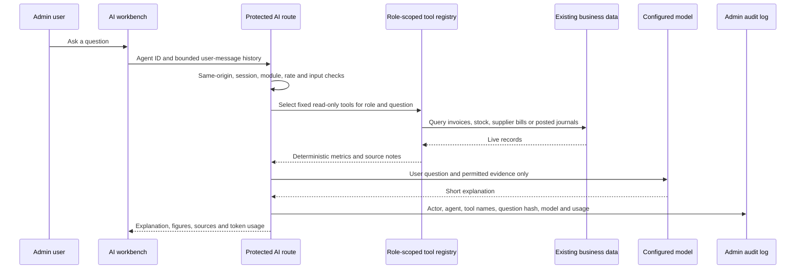

# AI agent architecture

## First-build scope

The admin AI workspace is a private, read-only business assistant. It adds a role-protected `/admin/ai` page and `/api/admin/ai` endpoint while preserving the existing public customer chatbot and staff image-identification flow. It uses the current Next.js App Router, existing admin sessions and RBAC, PostgREST data access, and the current `admin_audit_events` table. It adds no database tables and has no deployment steps.

## Request flow

This first build includes Business, Sales, Inventory, Purchasing and Accounting agents. Customer Support, Ecommerce SEO and Marketing agents remain follow-on work because the needed service/SEO/marketing data workflows are not present yet. The separate MCP server and approval workflow also remain follow-on work. The language model cannot select tools, issue database queries, or execute business actions. The server selects tools using a fixed intent map and checks the user's role again before each tool runs. The model receives only the resulting report and recent user messages; assistant messages supplied by the browser are discarded. Its response is displayed as plain text, never interpreted as HTML.

## DeepSeek Harness evaluation

The harness reference separates the agent loop, provider adapters, tool registry and durable session log. The current build follows the useful boundaries with a small internal provider adapter and fixed, role-scoped server tool registry. It does not add the harness dependency: the project describes the runtime as experimental developer-preview software, and its general-purpose execution capabilities need isolation from ERP data. Revisit it as a separately isolated service if durable agent sessions, MCP composition or human approval workflows become a defined requirement. The upstream project is MIT-licensed.

References: [core architecture](https://github.com/deepseek-ai/deepseek-harness/blob/master/docs/subsystems/core.md), [safety notice](https://github.com/deepseek-ai/deepseek-harness/blob/master/SAFETY.md), [license](https://github.com/deepseek-ai/deepseek-harness/blob/master/LICENSE).

## Agents and authorization

| Agent | Roles | Read-only data tools |
|---|---|---|
| Business copilot | Super Admin, Business Owner, Manager | Sales, inventory and accounting reports the user can access |
| Sales intelligence | Business roles, Sales Manager, Sales Staff, Cashier, Accountant | Issued invoice totals, best sellers, explicit product-profitability limitation |
| Inventory intelligence | Business roles, Inventory Manager, Warehouse Staff | Reorder-level alerts, signed stock movements, slow movers |
| Purchasing assistant | Business roles, Procurement Staff, Inventory Manager, Accountant | Recent posted supplier prices and reorder-level gaps |
| Accounting assistant | Business roles, Accountant | Period journal summaries and current receivable/payable controls |

The module, agent and each individual tool are permission-checked on the server. No customer names, phone numbers, emails or addresses are placed in model context. Supplier names and unit purchase prices are available only through the Purchasing agent's role set. AI requests use the same-origin check and admin session guard as existing admin APIs, plus a 12-request-per-minute per-IP limit.

## Data sources and deterministic calculations

- **Sales totals:** issued `invoices` and their `total_paisa`, bounded by Nepal-local date windows. Draft and voided invoices are excluded. The metric is invoiced value, not cash collected.
- **Best sellers:** issued `invoice_items`, grouped by SKU and ranked by quantity, with invoiced value as a tie-breaker.
- **Inventory:** tracked `products`, their configured `reorder_level`, and `stock_balances` summed across locations. The displayed gap only reaches the configured threshold; it is not a demand forecast or purchase quantity.
- **Slow movers:** tracked products with positive stock, compared to all issued invoice items. The report calls out that sales absent from the invoice system are not visible.
- **Stock movement:** signed entries from the append-only `stock_movements` ledger are grouped per product. Units are not added across different products.
- **Supplier price comparison:** latest posted purchase-bill unit price per supplier/product over the prior 365 days. Landed-cost allocation is not included.
- **Accounting:** `journal_entries`, `journal_lines` and `accounts`; income and expense figures are computed from posted debits/credits. Account codes come from the accounting module's shared `ACC` constants.

All monetary data is stored and summed as integer NPR paisa. Quantities are handled as fixed three-decimal integer units. Queries page through a stable order and fail closed above the 50,000-row analysis cap rather than returning a partial total. Each report labels its source and period, and the UI renders the deterministic figures separately from model prose.

## Model providers and configuration

Provider credentials stay on the server. The adapter supports:

- OpenAI Responses API (`openai`)
- Anthropic Messages API (`anthropic`)
- Chat Completions-compatible APIs (`deepseek`, `openai-compatible`)

Primary settings are `AI_PROVIDER`, `AI_MODEL`, `AI_API_KEY`, `AI_API_BASE_URL`, `AI_TIMEOUT_MS`, `AI_MAX_OUTPUT_TOKENS`, and `AI_TEMPERATURE`. The admin AI request limit can be set with `AI_RATE_LIMIT_PER_MINUTE` (1–60, default 12). The legacy OpenAI key/model remain accepted as the primary OpenAI credentials. Optional fallback settings use `AI_FALLBACK_PROVIDER`, `AI_FALLBACK_MODEL`, `AI_FALLBACK_API_KEY`, and `AI_FALLBACK_API_BASE_URL`. Remote base URLs must use HTTPS and cannot contain embedded credentials, query strings or fragments. An unauthenticated HTTP endpoint is accepted only for a loopback local model in development. No provider key is sent to the browser.

Temperature is configurable for Anthropic and Chat Completions-compatible providers; it is omitted from OpenAI Responses requests for compatibility with models that do not accept it. Output tokens are capped at 128–4,096. The adapter records input/output token counts returned by the provider. Set the primary and fallback `*_USD_PER_MILLION_TOKENS` settings in `.env.example` to estimate cost; rate values must match the configured model and should be kept current. If a provider omits token usage or rates are unset, cost remains unknown. A fallback is attempted once if the primary call fails. Provider failures return a generic response and do not expose upstream error bodies.

## Audit and privacy

Each accepted request must write to the existing append-only admin audit path before a response is returned, with actor email/role, selected agent, source/tool names, provider/model, fallback use, token counts, latency, outcome, and a SHA-256 hash of the latest question. Raw questions, model answers, provider keys and retrieved business rows are not stored in the audit record. The chat lives only in browser memory and is removed on refresh or when starting a new conversation. Provider data retention remains subject to that provider's account terms and settings; validate those terms before enabling confidential business queries.

## Known data-model limits

- Historical product profit is not calculated: invoice rows do not snapshot cost at sale, while the catalog cost can change. A current catalog cost must not be substituted.
- The chart-of-accounts receivable/payable balances have no due-date data; the assistant will not label them overdue or expose customer-level balances.
- Cash, bank and wallet values are ledger balances, not a bank reconciliation.
- Stock reorder levels do not encode lead time, minimum order quantities, seasonality or supplier constraints. The assistant reports the threshold gap only.
- Supplier comparisons use unit prices on posted bills and do not allocate freight, customs or other landed costs.
- Data queries cap at 50,000 rows and report unavailable above that cap rather than summarizing partial data.
- Rate limiting is per application process and IP; it is not a distributed quota service.
- Chat history, agent/provider administration UI, persistent token analytics, MCP exposure and approved write actions are not part of this first build.

## Safe extension path

New tools must be server-owned, read-only by default, typed, bounded, role-gated, and independently tested. Mutating tools require a separate proposal/approval flow, server-side reauthorization at approval time, idempotency, audit records and service-layer business validation. Do not add model-generated SQL or a generic database tool. Before adding customer-support or messaging tools, define identity verification and privacy controls first.